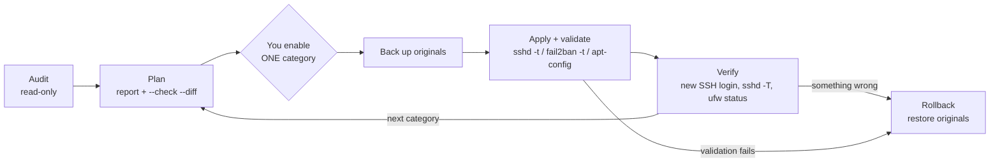

# server-hardening

🇹🇷 [Türkçe](README.tr.md)

[](https://github.com/rosko35/server-hardening/actions/workflows/ci.yml)


**Audit-first server hardening with Ansible for Ubuntu 24.04 and Debian 12, with a before/after Lynis score.**

Most hardening playbooks start by changing things. This one starts by *looking*.
Out of the box it only reads the server and writes a report on your machine: what is
listening, how SSH is really configured, which updates are pending, what a firewall would
block. Each fix is a separate category you switch on yourself, after a dry run, one at a time.

It was written for a real production VPS (website behind nginx + a mail server, SSH key login
as a non-root sudo user), where a careless playbook can lock you out or silently close port 25.

> **New to Linux or Ansible?** Start with the step-by-step guide: [docs/GUIDE.md](docs/GUIDE.md).

---

## Safety rules the code enforces

| Rule | How |
|---|---|
| **Audit by default** | Every `*_apply` switch is `false`. A test fails if any default changes. |
| **One category at a time** | Each category has its own switch and Makefile target; `CHECK=1` adds `--check --diff`. |
| **Never lock out SSH** | Config goes into a drop-in validated with `sshd -t` *before* it is installed; the full config is validated again; the effective config is verified with `sshd -T`; on any error the old file is restored and sshd is not touched. sshd is **reloaded**, not restarted, so your session survives. A brand-new SSH connection is opened at the end to prove login still works. |
| **Password login is only disabled when a key is proven** | The playbook expands `AuthorizedKeysFile` for the user *you* are logged in as and checks it with `ssh-keygen -l`. No valid key → the SSH category refuses to run. |
| **SSH port is never changed** | Not even optionally. A test checks no template contains `Port`. |
| **Firewall is built from reality** | Listening sockets are read with `ss`; the current SSH port is always the first rule; an empty allow list is refused; any public listener (mail/web!) that would be blocked must be explicitly acknowledged or the role refuses. This logic is Python and unit-tested. |
| **fail2ban never bans you** | Your current IP (from `$SSH_CLIENT`) is put in `ignoreip`; if it cannot be detected the role refuses. |
| **Everything is reversible** | Before the first change, each file's original is copied to `/var/backups/server-hardening/originals/` (or a "did not exist" marker is written). Previous modes, shells and sysctl values are saved too. `rollback.yml` restores them. |
| **Idempotent** | CI applies everything twice and fails if the second run reports `changed` > 0. |
| **No surprises** | No reboots (even `Automatic-Reboot` is forced off), no package removals, no `ip_forward` changes, nothing outside the categories you enable. |

## How it works



Every category role has two halves:

1. **preflight** (always runs, read-only, also tagged `audit`): collects facts and prints what it *would* do;
2. **apply** (only when `<category>_apply=true`): backs up, changes, validates, verifies.

The `audit` role runs last, turns the collected facts into findings (`filter_plugins/hardening_filters.py`)
and writes `reports/<host>/audit-report.md` and `audit-report.json` on the control machine.

## Quick start

The fastest way for a single server is **local mode**: clone the repository on the server
itself, Ansible manages the machine it runs on. No SSH from Ansible, nothing to install on Windows.

```bash
# on the server, logged in as your normal sudo user (not root)
sudo apt update && sudo apt install -y ansible git make
git clone https://github.com/rosko35/server-hardening.git
cd server-hardening
make audit LOCAL=1            # asks for your sudo password (-K), changes nothing
less reports/localhost/audit-report.md
```

Running from your laptop instead (Linux, macOS or WSL on Windows): copy
`inventory/hosts.example.yml` to `inventory/hosts.yml`, fill in your server, then `make audit`.
Full instructions for both ways, including WSL setup: [docs/GUIDE.md](docs/GUIDE.md).

## Commands

Every Makefile target prints the exact `ansible-playbook` command it runs. Add `LOCAL=1` for
local mode, `CHECK=1` for a dry run (`--check --diff`), `K=0` if you have passwordless sudo.

| Make target | Plain command (remote inventory) | What it does |
|---|---|---|
| `make audit` | `ansible-playbook -i inventory/hosts.yml -K site.yml --tags audit` | Read-only audit + report |
| `make apply-ssh CHECK=1` | `ansible-playbook -i inventory/hosts.yml -K site.yml --tags ssh -e ssh_hardening_apply=true --check --diff` | Show what the SSH category would change |
| `make apply-ssh` | same without `--check --diff` | Apply the SSH category |
| `make apply-firewall` | `... site.yml --tags firewall -e firewall_apply=true` | ufw (needs `firewall_allowed_ports`) |
| `make apply-auto-updates` | `... site.yml --tags auto_updates -e auto_updates_apply=true` | unattended-upgrades, security only |
| `make apply-fail2ban` | `... site.yml --tags fail2ban -e fail2ban_apply=true` | fail2ban sshd jail |
| `make apply-sysctl` | `... site.yml --tags sysctl -e sysctl_network_apply=true` | network sysctl baseline |
| `make apply-accounts` | `... site.yml --tags accounts -e accounts_apply=true` | login.defs (+ shell locking if enabled) |
| `make apply-file-permissions` | `... site.yml --tags file_permissions -e file_permissions_apply=true` | tighten sensitive file modes |
| `make lynis-before` | `ansible-playbook -i inventory/hosts.yml -K lynis.yml -e lynis_label=before -e lynis_apply=true` | Install Lynis (distro package) and score |
| `make lynis-after` | `... lynis.yml -e lynis_label=after` | Score again + comparison |
| `make compare` | `python3 scripts/compare_lynis.py reports/mail/lynis-before.dat reports/mail/lynis-after.dat` | Before/after table |
| `make rollback` | `ansible-playbook -i inventory/hosts.yml -K rollback.yml` | List what would be restored |
| `make rollback CONFIRM=1 CATEGORIES=ssh` | `... rollback.yml -e rollback_confirm=true -e rollback_categories=ssh` | Restore |

Local mode replaces `-i inventory/hosts.yml` with `-i inventory/localhost.yml`.

## What it checks and fixes

| Area | Audit checks | Fix (when enabled) | Toggle | Change risk | Safeguards |
|---|---|---|---|---|---|
| SSH | `sshd -T` effective config: root login, password / keyboard-interactive auth, MaxAuthTries, X11/agent forwarding, idle timeout; `sshd -t`; authorized key for your user | Drop-in `/etc/ssh/sshd_config.d/01-server-hardening.conf` | `ssh_hardening_apply` | **High** | key verified first; `sshd -t` before + after; `sshd -T` verification; auto-restore on failure; reload not restart; fresh-login test; never `Port` |
| Firewall | listening sockets + owning programs, ufw / nftables state, Docker | ufw: allow list (SSH first), default deny incoming, enable | `firewall_apply` + `firewall_allowed_ports` | **High** | empty list refused; mail/web listeners that would close → refusal unless acknowledged; SSH rule verified after enable |
| Updates | pending (security) updates, reboot-required, unattended-upgrades state | unattended-upgrades limited to the security pocket, `Automatic-Reboot "false"` | `auto_updates_apply` | Low | own files in `apt.conf.d` (validated with `apt-config`), optional package blacklist (e.g. `postfix`) |
| Brute force | fail2ban installed / running | fail2ban `sshd` jail, systemd backend | `fail2ban_apply` | Low–Medium | your IP in `ignoreip`; refuses if unknown; `fail2ban-client --test` |
| Network kernel | redirects, source routing, martians, syncookies, broadcast ICMP | `/etc/sysctl.d/60-server-hardening.conf` | `sysctl_network_apply` | Medium | never touches `ip_forward`; only keys present on the kernel; previous runtime values saved |
| Accounts | users with shells, admin groups, NOPASSWD rules, extra UID 0, login.defs | login.defs ageing defaults (new accounts only) | `accounts_apply` | Low | `UMASK` unmanaged by default (would break `/var/www` deploys) |
| Accounts | system accounts (uid < 1000) with a login shell | shell → `/usr/sbin/nologin` | `accounts_lock_system_shells` | Medium | separate opt-in; exclude list (`postgres`, `git`, ...); old shells saved |
| Files | modes of sshd_config, crontab, cron dirs, shadow, grub.cfg; world-writable + SUID (bounded scan) | remove extra permission bits | `file_permissions_apply` | Low | only ever *removes* bits (intersection of current and wanted) |
| Services | failed systemd units | – (report only) | – | – | – |
| Score | Lynis hardening index, warnings, suggestions | install Lynis (distro package or pinned tarball + SHA-256) | `lynis_apply` | Low | upstream download refused without a pinned checksum |

All switches with their documentation: [`group_vars/all.yml`](group_vars/all.yml).

## Riskiest tasks (read before enabling)

Ranked by how badly they can hurt a web + mail server, and what stands in the way:

1. **Firewall enable (`firewall_apply`)** – can cut off SSH, port 25/465/587/993 and 80/443 at once.
   *Safeguards:* refuses an empty allow list; current SSH port (taken from your live session) is always rule #1;
   publicly listening ports that would be blocked are listed with their program and the role refuses unless you
   acknowledge each one; allow rules are added *before* `default deny`; SSH rule checked in `ufw status` after enabling.
2. **Disabling password / keyboard-interactive SSH login (`ssh_hardening_apply`)** – locks out anyone without a key.
   *Safeguards:* refuses unless a valid key is found in *your* `AuthorizedKeysFile`; PubkeyAuthentication can never be set to `no`.
3. **Any sshd change** – a typo means no SSH after the next restart.
   *Safeguards:* `sshd -t -f` on the new file, `sshd -t` on the whole config, `sshd -T` value check, automatic restore + stop on
   failure, reload (sessions stay), new-connection test.
4. **`PermitRootLogin no`** – fatal if you only log in as root. *Safeguard:* skipped automatically when the operator is root.
5. **Locking system account shells (`accounts_lock_system_shells`)** – can break services that `su` into an account.
   *Safeguards:* separate second opt-in, exclude list, previous shells saved, audit lists the accounts first.
6. **sysctl network settings** – strict reverse-path filtering can drop traffic on multi-homed hosts.
   *Safeguards:* `rp_filter` untouched unless `sysctl_network_strict_rp_filter=true`; forwarding keys rejected by an assertion.
7. **fail2ban** – could ban a colleague or your mail client. *Safeguards:* your IP in `ignoreip`, extra IPs configurable, unban command printed.
8. **Automatic updates** – an update restarts nginx/postfix briefly. *Safeguards:* security pocket only, never reboots, optional blacklist.

## What this deliberately does NOT do

- **Change the SSH port.** It barely reduces risk and is the most common way to lock yourself out.
- **Reboot**, ever. Not even after kernel updates – you choose when.
- **Remove packages** or purge "unneeded" services.
- **Touch `ip_forward`** or anything Docker/VPN routing depends on.
- **Change `/etc/sudoers`.** NOPASSWD rules are reported, not removed (removing them could lock you out of sudo).
- **Set a restrictive `UMASK`** by default (027 breaks files your user deploys to `/var/www`).
- **Configure mail or nginx TLS.** That belongs to those services' own configuration.
- **Promise compliance** (CIS etc.). It is a careful baseline for one small server.
- **Run on anything but Ubuntu 24.04 / Debian 12** without warning you.

## Rollback

```bash
make rollback                          # lists what would be restored, changes nothing
make rollback CONFIRM=1                # restore everything
make rollback CONFIRM=1 CATEGORIES=ssh,firewall
```

Rollback restores original files (or deletes the ones this project created), re-validates and reloads sshd,
disables ufw if it was inactive before, restores sysctl runtime values, previous shells and file modes.
Installed packages stay installed. Manual escape hatches are printed after every apply and documented in the guide,
including how to get in through the provider's web console if SSH is broken.

## Results

> These placeholders are filled from real runs with `scripts/compare_lynis.py` – numbers are never typed in by hand.

**Production VPS (Ubuntu 24.04, nginx + mail):**

<!-- RESULTS:START - paste the output of: python3 scripts/compare_lynis.py reports/<host>/lynis-before.dat reports/<host>/lynis-after.dat -->
| Metric | Before | After | Change |
|---|---:|---:|---:|
| **Lynis hardening index** | _TBD_ | _TBD_ | _TBD_ |
| Warnings | _TBD_ | _TBD_ | _TBD_ |
| Suggestions | _TBD_ | _TBD_ | _TBD_ |
| Tests performed | _TBD_ | _TBD_ | _TBD_ |
<!-- RESULTS:END -->

Categories applied: _TBD_. The CI job also prints a before/after table for its throw-away container in the run summary;
that number describes a bare container, not a real server.

## Screenshots

> 📸 _Placeholder:_ `docs/screenshots/audit-run.png` – terminal output of `make audit`
>
> 📸 _Placeholder:_ `docs/screenshots/audit-report.png` – the findings table in `audit-report.md`
>
> 📸 _Placeholder:_ `docs/screenshots/firewall-refusal.png` – the firewall role refusing to close port 587
>
> 📸 _Placeholder:_ `docs/screenshots/lynis-compare.png` – before/after Lynis table

## Testing

| What | Where | Runs the playbooks? |
|---|---|---|
| yamllint, ruff | locally + CI | no |
| pytest: firewall plan logic, audit findings, file-mode logic, sshd parsing, rollback planning, every Jinja2 template rendered with StrictUndefined, Jinja syntax + filter names in all tasks, YAML validity, "every toggle defaults to off", "no reboot / package removal / Port" rules, Lynis parser + comparison, recap checker | locally + CI (Python 3.10–3.13) | no |
| ansible-lint (production profile), `ansible-playbook --syntax-check` | CI | no |
| **Integration** in a systemd Ubuntu 24.04 *and* Debian 12 container that mimics a web + mail VPS (sshd, nginx, a service on :587, key-only operator) | CI | **yes**: audit must not change `/etc`; `--check` must not change `/etc`; refusals (empty allow list, unacknowledged mail port, no key) must refuse; apply everything twice → second run `changed=0`; then `sshd -t`, a *new* key login works, password login is refused, the website is reachable through ufw, port 587 is filtered, fail2ban ignores the operator; Lynis before/after; rollback restores login, ufw, files, modes, shells and sysctl |

```bash
python -m venv .venv && . .venv/bin/activate      # Windows: .venv\Scripts\activate
pip install -r requirements-dev.txt
pytest && yamllint -s . && ruff check .
```

## Project layout

```text
server-hardening/
├── ansible.cfg
├── site.yml                 # audit + categories (all opt-in)
├── lynis.yml                # Lynis before/after
├── rollback.yml             # restore backups
├── Makefile                 # thin wrapper, prints every command
├── group_vars/all.yml       # every switch, documented, safe defaults
├── inventory/
│   ├── hosts.example.yml    # copy to hosts.yml (git-ignored)
│   └── localhost.yml        # local mode
├── filter_plugins/
│   └── hardening_filters.py # decision logic (firewall plan, findings, modes...) - unit-tested
├── roles/
│   ├── common/              # preflight facts + backup helper
│   ├── audit/               # report (Markdown + JSON)
│   ├── ssh_hardening/  firewall/  auto_updates/  fail2ban/
│   ├── sysctl_network/  accounts/  file_permissions/
│   ├── lynis/
│   └── rollback/
├── scripts/
│   ├── lynis_report.py      # lynis-report.dat -> JSON / Markdown
│   ├── compare_lynis.py     # before/after table
│   └── check_recap.py       # idempotence gate for CI
├── tests/                   # pytest + fixtures
├── ci/                      # test container, integration script
├── docs/GUIDE.md            # beginner walkthrough (EN)
└── docs/REHBER.tr.md        # beginner walkthrough (TR)
```

## Why I built this / what I learned

I have exactly one server that matters: a small VPS that runs my website and my mail. When I started
reading hardening guides, almost all of them began with "disable password login, change the SSH port,
enable the firewall" – three things that, done in the wrong order, lock you out of the only machine you have.
I did not want a script that is clever; I wanted one that is *careful*, and that I could actually explain line by line.

What I learned building it:

- **Read before you write.** A server's real state is often not what its main config file says: a cloud image can
  re-enable password login in a drop-in, sudo can be passwordless, a service can listen publicly by accident.
  So the audit comes first and everything else is built on what it finds.
- **sshd's first-value-wins rule** and the `Include` at the top of `sshd_config` – which is why the drop-in is called `01-...`,
  and why I verify the *effective* config with `sshd -T` instead of trusting the file I wrote.
- **reload vs restart**, and that an open SSH session is the best rollback tool you have.
- **Firewalls fail closed.** Building the rule set from `ss` output, and refusing when a mail port would silently close,
  is the part I am proudest of – and the part with the most tests.
- **Idempotence has to be tested, not assumed.** That is why CI applies everything twice and fails on any "changed"
  in the second run – a task that always reports "changed" hides the one change that matters.
- **Keep decisions out of YAML.** Logic in a small Python filter plugin can be unit-tested on my Windows laptop,
  where Ansible itself does not even run.
- **Ansible details that bite:** tags are not inherited by dynamic includes, `--check` skips commands, `ansible.cfg`
  is ignored in world-writable directories (hello, `/mnt/c` in WSL).

## License

[MIT](LICENSE) © Emre Özaydın
