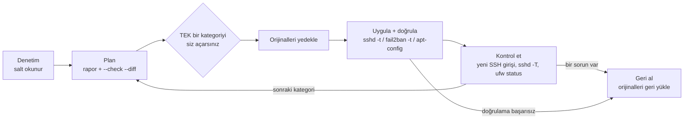

# server-hardening

🇬🇧 [English](README.md)

[](https://github.com/rosko35/server-hardening/actions/workflows/ci.yml)


**Ubuntu 24.04 ve Debian 12 için Ansible ile "önce denetle" yaklaşımlı sunucu sıkılaştırma; öncesi/sonrası Lynis puanıyla.**

Çoğu sıkılaştırma playbook'u işe bir şeyleri değiştirerek başlar. Bu proje önce *bakar*.
Varsayılan hâliyle sunucuyu yalnızca okur ve kendi bilgisayarınıza bir rapor yazar: hangi portlar
dinleniyor, SSH gerçekte nasıl yapılandırılmış, hangi güncellemeler bekliyor, bir güvenlik duvarı
neyi engellerdi. Her düzeltme ayrı bir kategoridir; önce kuru çalıştırma (dry run) yapıp, birer birer
kendiniz açarsınız.

Gerçek bir üretim VPS'i için yazıldı (nginx arkasında web sitesi + e-posta sunucusu, root olmayan
sudo kullanıcısıyla SSH anahtarı ile giriş). Böyle bir sunucuda dikkatsiz bir playbook sizi dışarıda
bırakabilir ya da 25 numaralı portu sessizce kapatabilir.

> **Linux'a veya Ansible'a yeni misiniz?** Adım adım rehberle başlayın: [docs/REHBER.tr.md](docs/REHBER.tr.md).

---

## Kodun uyguladığı güvenlik kuralları

| Kural | Nasıl |
|---|---|
| **Varsayılan: yalnızca denetim** | Tüm `*_apply` anahtarları `false`. Bir varsayılan değişirse test başarısız olur. |
| **Her seferinde tek kategori** | Her kategorinin kendi anahtarı ve Makefile hedefi var; `CHECK=1` `--check --diff` ekler. |
| **SSH'tan asla kilitlenmemek** | Ayarlar, yerine konmadan *önce* `sshd -t` ile doğrulanan bir drop-in dosyasına yazılır; tüm yapılandırma tekrar doğrulanır; etkin ayarlar `sshd -T` ile kontrol edilir; herhangi bir hatada eski dosya geri yüklenir ve sshd'ye dokunulmaz. sshd **reload** edilir, restart edilmez; açık oturumunuz kapanmaz. Sonunda yeni bir SSH bağlantısı açılarak girişin hâlâ çalıştığı kanıtlanır. |
| **Parola girişi yalnızca anahtar kanıtlanınca kapatılır** | Playbook, bağlı olduğunuz kullanıcının `AuthorizedKeysFile` yollarını açar ve `ssh-keygen -l` ile kontrol eder. Geçerli anahtar yoksa SSH kategorisi çalışmayı reddeder. |
| **SSH portu asla değiştirilmez** | Seçenek olarak bile yok. Hiçbir şablonun `Port` içermediğini bir test kontrol eder. |
| **Güvenlik duvarı gerçeğe göre kurulur** | Dinleyen soketler `ss` ile okunur; mevcut SSH portu her zaman ilk kuraldır; boş izin listesi reddedilir; engellenecek her açık dinleyici (e-posta/web!) açıkça onaylanmazsa rol çalışmayı reddeder. Bu mantık Python'dadır ve birim testleri vardır. |
| **fail2ban sizi asla banlamaz** | Mevcut IP'niz (`$SSH_CLIENT`'tan) `ignoreip`'e eklenir; tespit edilemezse rol reddeder. |
| **Her şey geri alınabilir** | İlk değişiklikten önce her dosyanın orijinali `/var/backups/server-hardening/originals/` altına kopyalanır (ya da "yoktu" işaretçisi yazılır). Önceki dosya izinleri, kabuklar ve sysctl değerleri de saklanır. `rollback.yml` hepsini geri yükler. |
| **Idempotent** | CI her şeyi iki kez uygular; ikinci çalıştırma `changed` > 0 raporlarsa başarısız olur. |
| **Sürpriz yok** | Yeniden başlatma yok (`Automatic-Reboot` bile zorla kapalı), paket kaldırma yok, `ip_forward` değişikliği yok, açmadığınız kategorilerin dışında hiçbir şey yok. |

## Nasıl çalışır



Her kategori rolünün iki yarısı vardır:

1. **preflight** (her zaman çalışır, salt okunur, `audit` etiketi de taşır): bilgi toplar ve ne *yapacağını* yazdırır;
2. **apply** (yalnızca `<kategori>_apply=true` olduğunda): yedekler, değiştirir, doğrular, kontrol eder.

`audit` rolü en son çalışır, toplanan bilgileri bulgulara çevirir (`filter_plugins/hardening_filters.py`)
ve kontrol makinesine `reports/<host>/audit-report.md` ile `audit-report.json` dosyalarını yazar.

## Hızlı başlangıç

Tek bir sunucu için en hızlı yol **yerel mod**dur: depoyu sunucunun kendisine klonlarsınız, Ansible
üzerinde çalıştığı makineyi yönetir. Ansible SSH kullanmaz, Windows'a hiçbir şey kurmanız gerekmez.

```bash
# sunucuda, normal sudo kullanıcınızla (root DEĞİL)
sudo apt update && sudo apt install -y ansible git make
git clone https://github.com/rosko35/server-hardening.git
cd server-hardening
make audit LOCAL=1            # sudo parolanızı sorar (-K), hiçbir şeyi değiştirmez
less reports/localhost/audit-report.md
```

Bunun yerine dizüstü bilgisayarınızdan (Linux, macOS ya da Windows'ta WSL) çalıştırmak için:
`inventory/hosts.example.yml` dosyasını `inventory/hosts.yml` olarak kopyalayın, sunucunuzu yazın, sonra `make audit`.
WSL kurulumu dahil iki yolun tam anlatımı: [docs/REHBER.tr.md](docs/REHBER.tr.md).

## Komutlar

Her Makefile hedefi çalıştırdığı `ansible-playbook` komutunun tamamını ekrana yazar. Yerel mod için
`LOCAL=1`, kuru çalıştırma (`--check --diff`) için `CHECK=1`, parolasız sudo kullanıyorsanız `K=0` ekleyin.

| Make hedefi | Düz komut (uzak envanter) | Ne yapar |
|---|---|---|
| `make audit` | `ansible-playbook -i inventory/hosts.yml -K site.yml --tags audit` | Salt okunur denetim + rapor |
| `make apply-ssh CHECK=1` | `ansible-playbook -i inventory/hosts.yml -K site.yml --tags ssh -e ssh_hardening_apply=true --check --diff` | SSH kategorisinin neyi değiştireceğini gösterir |
| `make apply-ssh` | aynısı, `--check --diff` olmadan | SSH kategorisini uygular |
| `make apply-firewall` | `... site.yml --tags firewall -e firewall_apply=true` | ufw (`firewall_allowed_ports` gerekir) |
| `make apply-auto-updates` | `... site.yml --tags auto_updates -e auto_updates_apply=true` | unattended-upgrades, yalnızca güvenlik |
| `make apply-fail2ban` | `... site.yml --tags fail2ban -e fail2ban_apply=true` | fail2ban sshd jail'i |
| `make apply-sysctl` | `... site.yml --tags sysctl -e sysctl_network_apply=true` | ağ sysctl temel ayarları |
| `make apply-accounts` | `... site.yml --tags accounts -e accounts_apply=true` | login.defs (+ açıksa kabuk kilitleme) |
| `make apply-file-permissions` | `... site.yml --tags file_permissions -e file_permissions_apply=true` | hassas dosya izinlerini sıkılaştırır |
| `make lynis-before` | `ansible-playbook -i inventory/hosts.yml -K lynis.yml -e lynis_label=before -e lynis_apply=true` | Lynis'i kurar (dağıtım paketi) ve puanlar |
| `make lynis-after` | `... lynis.yml -e lynis_label=after` | Tekrar puanlar + karşılaştırma |
| `make compare` | `python3 scripts/compare_lynis.py reports/mail/lynis-before.dat reports/mail/lynis-after.dat` | Öncesi/sonrası tablosu |
| `make rollback` | `ansible-playbook -i inventory/hosts.yml -K rollback.yml` | Neyin geri yükleneceğini listeler |
| `make rollback CONFIRM=1 CATEGORIES=ssh` | `... rollback.yml -e rollback_confirm=true -e rollback_categories=ssh` | Geri yükler |

Yerel modda `-i inventory/hosts.yml` yerine `-i inventory/localhost.yml` kullanılır.

## Neyi denetler, neyi düzeltir

| Alan | Denetim | Düzeltme (açıldığında) | Anahtar | Değişiklik riski | Önlemler |
|---|---|---|---|---|---|
| SSH | `sshd -T` etkin ayarları: root girişi, parola / keyboard-interactive, MaxAuthTries, X11/agent yönlendirme, boşta zaman aşımı; `sshd -t`; kullanıcınız için yetkili anahtar | `/etc/ssh/sshd_config.d/01-server-hardening.conf` drop-in'i | `ssh_hardening_apply` | **Yüksek** | önce anahtar doğrulanır; öncesinde + sonrasında `sshd -t`; `sshd -T` kontrolü; hatada otomatik geri yükleme; restart değil reload; yeni giriş testi; asla `Port` yok |
| Güvenlik duvarı | dinleyen soketler + sahibi olan programlar, ufw / nftables durumu, Docker | ufw: izin listesi (önce SSH), gelenler için varsayılan deny, etkinleştirme | `firewall_apply` + `firewall_allowed_ports` | **Yüksek** | boş liste reddedilir; kapanacak e-posta/web dinleyicileri onaylanmadıkça reddedilir; etkinleştirmeden sonra SSH kuralı kontrol edilir |
| Güncellemeler | bekleyen (güvenlik) güncellemeleri, reboot-required, unattended-upgrades durumu | yalnızca security deposuna sınırlı unattended-upgrades, `Automatic-Reboot "false"` | `auto_updates_apply` | Düşük | `apt.conf.d` içinde kendi dosyaları (`apt-config` ile doğrulanır), isteğe bağlı paket kara listesi (ör. `postfix`) |
| Kaba kuvvet | fail2ban kurulu / çalışıyor mu | fail2ban `sshd` jail'i, systemd backend | `fail2ban_apply` | Düşük–Orta | IP'niz `ignoreip`'te; bilinmiyorsa reddeder; `fail2ban-client --test` |
| Ağ çekirdek ayarları | redirect'ler, source routing, martian'lar, syncookies, broadcast ICMP | `/etc/sysctl.d/60-server-hardening.conf` | `sysctl_network_apply` | Orta | `ip_forward`'a asla dokunmaz; yalnızca çekirdekte bulunan anahtarlar; önceki çalışma zamanı değerleri saklanır |
| Hesaplar | kabuğu olan kullanıcılar, yönetici grupları, NOPASSWD kuralları, fazladan UID 0, login.defs | login.defs parola yaşlandırma varsayılanları (yalnızca yeni hesaplar) | `accounts_apply` | Düşük | `UMASK` varsayılan olarak yönetilmez (`/var/www`'ye dosya atmayı bozardı) |
| Hesaplar | giriş kabuğu olan sistem hesapları (uid < 1000) | kabuk → `/usr/sbin/nologin` | `accounts_lock_system_shells` | Orta | ayrı ikinci onay; hariç listesi (`postgres`, `git`, ...); eski kabuklar saklanır |
| Dosyalar | sshd_config, crontab, cron dizinleri, shadow, grub.cfg izinleri; herkesin yazabildiği dosyalar + SUID (sınırlı tarama) | fazla izin bitlerini kaldırır | `file_permissions_apply` | Düşük | yalnızca bit *kaldırır* (mevcut ve istenen iznin kesişimi) |
| Servisler | başarısız systemd birimleri | – (yalnızca rapor) | – | – | – |
| Puan | Lynis hardening index, uyarılar, öneriler | Lynis kurulumu (dağıtım paketi ya da sabitlenmiş tarball + SHA-256) | `lynis_apply` | Düşük | sabitlenmiş checksum olmadan upstream indirme reddedilir |

Açıklamalarıyla birlikte tüm anahtarlar: [`group_vars/all.yml`](group_vars/all.yml).

## En riskli görevler (açmadan önce okuyun)

Web + e-posta sunucusuna ne kadar zarar verebileceklerine göre sıralı, ve önlerinde ne duruyor:

1. **Güvenlik duvarını açmak (`firewall_apply`)** – SSH'ı, 25/465/587/993 ve 80/443 portlarını bir anda kesebilir.
   *Önlemler:* boş izin listesini reddeder; mevcut SSH portu (canlı oturumunuzdan alınır) her zaman 1 numaralı kuraldır;
   engellenecek açık portlar programlarıyla listelenir ve her birini onaylamazsanız rol reddeder; izin kuralları
   `default deny`'dan *önce* eklenir; etkinleştirdikten sonra `ufw status` içinde SSH kuralı kontrol edilir.
2. **SSH'ta parola / keyboard-interactive girişini kapatmak (`ssh_hardening_apply`)** – anahtarı olmayan herkesi dışarıda bırakır.
   *Önlemler:* *sizin* `AuthorizedKeysFile` dosyanızda geçerli bir anahtar yoksa reddeder; PubkeyAuthentication asla `no` yapılamaz.
3. **Her türlü sshd değişikliği** – bir yazım hatası, bir sonraki yeniden başlatmada SSH'ın olmaması demektir.
   *Önlemler:* yeni dosyada `sshd -t -f`, tüm yapılandırmada `sshd -t`, `sshd -T` değer kontrolü, hatada otomatik geri
   yükleme + durma, reload (oturumlar açık kalır), yeni bağlantı testi.
4. **`PermitRootLogin no`** – yalnızca root ile giriyorsanız ölümcül. *Önlem:* operatör root ise otomatik atlanır.
5. **Sistem hesaplarının kabuklarını kilitlemek (`accounts_lock_system_shells`)** – bir hesaba `su` yapan servisleri bozabilir.
   *Önlemler:* ayrı ikinci onay, hariç listesi, önceki kabuklar saklanır, denetim önce hesapları listeler.
6. **sysctl ağ ayarları** – katı reverse-path filtreleme, birden fazla ağ arayüzü olan sunucularda trafiği düşürebilir.
   *Önlemler:* `sysctl_network_strict_rp_filter=true` değilse `rp_filter`'a dokunulmaz; forwarding anahtarları bir assert ile reddedilir.
7. **fail2ban** – bir iş arkadaşınızı ya da e-posta istemcinizi banlayabilir. *Önlemler:* IP'niz `ignoreip`'te, ek IP'ler ayarlanabilir, ban kaldırma komutu yazdırılır.
8. **Otomatik güncellemeler** – bir güncelleme nginx/postfix'i kısa süre yeniden başlatır. *Önlemler:* yalnızca security deposu, asla reboot yok, isteğe bağlı kara liste.

## Bilerek YAPMADIKLARI

- **SSH portunu değiştirmek.** Riski neredeyse hiç azaltmaz ve kendinizi dışarıda bırakmanın en yaygın yoludur.
- **Yeniden başlatmak**, hiçbir zaman. Çekirdek güncellemesinden sonra bile – zamanı siz seçersiniz.
- **Paket kaldırmak** ya da "gereksiz" servisleri silmek.
- **`ip_forward`'a** ya da Docker/VPN yönlendirmesinin bağlı olduğu herhangi bir şeye dokunmak.
- **`/etc/sudoers`'ı değiştirmek.** NOPASSWD kuralları raporlanır, kaldırılmaz (kaldırmak sizi sudo'dan kilitleyebilir).
- **Varsayılan olarak kısıtlayıcı bir `UMASK`** ayarlamak (027, kullanıcınızın `/var/www`'ye attığı dosyaları bozar).
- **E-posta ya da nginx TLS yapılandırmak.** Bunlar o servislerin kendi yapılandırmasına aittir.
- **Uyumluluk vaat etmek** (CIS vb.). Tek bir küçük sunucu için dikkatli bir temel ayardır.
- **Ubuntu 24.04 / Debian 12 dışında** sizi uyarmadan çalışmak.

## Geri alma

```bash
make rollback                          # neyin geri yükleneceğini listeler, hiçbir şeyi değiştirmez
make rollback CONFIRM=1                # her şeyi geri yükler
make rollback CONFIRM=1 CATEGORIES=ssh,firewall
```

Geri alma, orijinal dosyaları geri yükler (ya da bu projenin oluşturduklarını siler), sshd'yi yeniden doğrulayıp reload
eder, ufw önceden kapalıysa kapatır, sysctl çalışma zamanı değerlerini, önceki kabukları ve dosya izinlerini geri getirir;
fail2ban önceden çalışmıyorsa onu yeniden durdurur (dağıtımın varsayılan jail'iyle çalışmaya devam etmesin diye).
Kurulan paketler kurulu kalır. Elle kurtulma yolları her uygulamadan sonra ekrana yazılır ve rehberde anlatılır;
SSH bozulursa sağlayıcının web konsolundan nasıl girileceği de dahil.

## Sonuçlar

> Bu yer tutucular gerçek çalıştırmalardan `scripts/compare_lynis.py` ile doldurulur – sayılar asla elle yazılmaz.

**Üretim VPS'i (Ubuntu 24.04, nginx + e-posta):**

<!-- RESULTS:START - şunun çıktısını yapıştırın: python3 scripts/compare_lynis.py reports/<host>/lynis-before.dat reports/<host>/lynis-after.dat -->
| Metric | Before | After | Change |
|---|---:|---:|---:|
| **Lynis hardening index** | _TBD_ | _TBD_ | _TBD_ |
| Warnings | _TBD_ | _TBD_ | _TBD_ |
| Suggestions | _TBD_ | _TBD_ | _TBD_ |
| Tests performed | _TBD_ | _TBD_ | _TBD_ |
<!-- RESULTS:END -->

Uygulanan kategoriler: _TBD_. CI işi de kendi geçici konteyneri için çalıştırma özetine bir öncesi/sonrası tablosu
yazar; o sayı gerçek bir sunucuyu değil, çıplak bir konteyneri anlatır.

## Ekran görüntüleri

> 📸 _Yer tutucu:_ `docs/screenshots/audit-run.png` – `make audit` terminal çıktısı
>
> 📸 _Yer tutucu:_ `docs/screenshots/audit-report.png` – `audit-report.md` içindeki bulgular tablosu
>
> 📸 _Yer tutucu:_ `docs/screenshots/firewall-refusal.png` – güvenlik duvarı rolünün 587 portunu kapatmayı reddetmesi
>
> 📸 _Yer tutucu:_ `docs/screenshots/lynis-compare.png` – öncesi/sonrası Lynis tablosu

## Testler

| Ne | Nerede | Playbook'ları çalıştırır mı? |
|---|---|---|
| yamllint, ruff | yerelde + CI | hayır |
| pytest: güvenlik duvarı plan mantığı, denetim bulguları, dosya izni mantığı, sshd ayrıştırma, geri alma planlaması, her Jinja2 şablonunun StrictUndefined ile işlenmesi, tüm görevlerde Jinja sözdizimi + filtre adları, YAML geçerliliği, "her anahtar varsayılan olarak kapalı", "reboot / paket kaldırma / Port yok" kuralları, Lynis ayrıştırıcı + karşılaştırma, recap denetleyici | yerelde + CI (Python 3.10–3.13) | hayır |
| ansible-lint (production profili), `ansible-playbook --syntax-check` | CI | hayır |
| **Entegrasyon**: web + e-posta VPS'ini taklit eden systemd'li Ubuntu 24.04 *ve* Debian 12 konteyneri (sshd, nginx, :587'de bir servis, yalnızca anahtarlı operatör) | CI | **evet**: denetim `/etc`'yi değiştirmemeli; `--check` `/etc`'yi değiştirmemeli; reddetmeler (boş izin listesi, onaylanmamış e-posta portu, anahtar yok) reddetmeli; her şey iki kez uygulanır → ikinci çalıştırma `changed=0`; ardından `sshd -t`, *yeni* bir anahtarlı giriş çalışır, parola girişi reddedilir, web sitesine ufw üzerinden erişilir, 587 portu filtrelenir, fail2ban operatörü yok sayar; Lynis öncesi/sonrası; geri alma girişi, ufw'yi, dosyaları, izinleri, kabukları ve sysctl'i geri getirir, fail2ban'i yeniden durdurur |

```bash
python -m venv .venv && . .venv/bin/activate      # Windows: .venv\Scripts\activate
pip install -r requirements-dev.txt
pytest && yamllint -s . && ruff check .
```

Bir entegrasyon aşaması başarısız olursa, hata veren Ansible görevi ve günlüğün son satırları ayrıca
**annotation** olarak yayımlanır (`ci/annotate.py`); tanılama adımı da `systemctl --failed`, `sshd -T`, `ufw status`
çıktısını ve journal uyarılarını aynı şekilde ekler. Annotation'lar çalıştırma sayfasında görünür ve oturum açmadan
okunabilir:

```bash
curl -s https://api.github.com/repos/rosko35/server-hardening/commits/<sha>/check-runs   # her kaydın bir "annotations_url" alanı var
curl -s <annotations_url>
```

## Proje yapısı

```text
server-hardening/
├── ansible.cfg
├── site.yml                 # denetim + kategoriler (hepsi isteğe bağlı)
├── lynis.yml                # Lynis öncesi/sonrası
├── rollback.yml             # yedekleri geri yükler
├── Makefile                 # ince sarmalayıcı, her komutu yazdırır
├── group_vars/all.yml       # tüm anahtarlar, açıklamalı, güvenli varsayılanlar
├── inventory/
│   ├── hosts.example.yml    # hosts.yml olarak kopyalayın (git'e girmez)
│   └── localhost.yml        # yerel mod
├── filter_plugins/
│   └── hardening_filters.py # karar mantığı (güvenlik duvarı planı, bulgular, izinler...) - birim testli
├── roles/
│   ├── common/              # ön kontrol bilgileri + yedekleme yardımcısı
│   ├── audit/               # rapor (Markdown + JSON)
│   ├── ssh_hardening/  firewall/  auto_updates/  fail2ban/
│   ├── sysctl_network/  accounts/  file_permissions/
│   ├── lynis/
│   └── rollback/
├── scripts/
│   ├── lynis_report.py      # lynis-report.dat -> JSON / Markdown
│   ├── compare_lynis.py     # öncesi/sonrası tablosu
│   └── check_recap.py       # CI için idempotence kapısı
├── tests/                   # pytest + fixture'lar
├── ci/                      # test konteyneri, entegrasyon betiği
├── docs/GUIDE.md            # başlangıç rehberi (EN)
└── docs/REHBER.tr.md        # başlangıç rehberi (TR)
```

## Neden yaptım / ne öğrendim

Gerçekten önemli olan tek bir sunucum var: web sitemi ve e-postamı çalıştıran küçük bir VPS. Sıkılaştırma
rehberlerini okumaya başladığımda neredeyse hepsi "parola girişini kapat, SSH portunu değiştir, güvenlik duvarını
aç" diye başlıyordu – yanlış sırayla yapıldığında elinizdeki tek makineden sizi dışarıda bırakan üç şey.
Akıllı bir betik istemedim; *dikkatli* bir betik istedim, ve satır satır açıklayabileceğim bir betik.

Yaparken öğrendiklerim:

- **Yazmadan önce oku.** Bir sunucunun gerçek durumu çoğu zaman ana yapılandırma dosyasının söylediği değildir:
  bir bulut imajı parola girişini bir drop-in ile tekrar açabilir, sudo parolasız olabilir, bir servis yanlışlıkla
  dışarıya açık dinliyor olabilir. Bu yüzden önce denetim geliyor ve geri kalan her şey onun bulduklarının üzerine kuruluyor.
- **sshd'nin "ilk değer kazanır" kuralı** ve `sshd_config`'in en üstündeki `Include` – drop-in'in adının neden `01-...`
  olduğu ve yazdığım dosyaya güvenmek yerine *etkin* yapılandırmayı neden `sshd -T` ile doğruladığım.
- **reload ile restart arasındaki fark**, ve açık bir SSH oturumunun elinizdeki en iyi geri alma aracı olduğu.
- **Güvenlik duvarları kapalı tarafta hata verir.** Kural setini `ss` çıktısından kurmak ve bir e-posta portu sessizce
  kapanacaksa reddetmek, en çok önemsediğim kısım – ve en çok testi olan kısım.
- **Idempotence varsayılmaz, test edilir.** Bu yüzden CI her şeyi iki kez uygular ve ikinci çalıştırmadaki her
  "changed" için başarısız olur – sürekli "changed" diyen bir görev, önemli olan tek değişikliği gizler.
- **Kararları YAML'ın dışında tut.** Küçük bir Python filtre eklentisindeki mantık, Ansible'ın çalışmadığı Windows
  dizüstü bilgisayarımda bile birim testiyle sınanabiliyor.
- **Can yakan Ansible ayrıntıları:** etiketler dinamik include'lara miras geçmez, `--check` komutları atlar, `ansible.cfg`
  herkesin yazabildiği dizinlerde yok sayılır (WSL'de `/mnt/c`, merhaba).

## Lisans

[MIT](LICENSE) © Emre Özaydın
